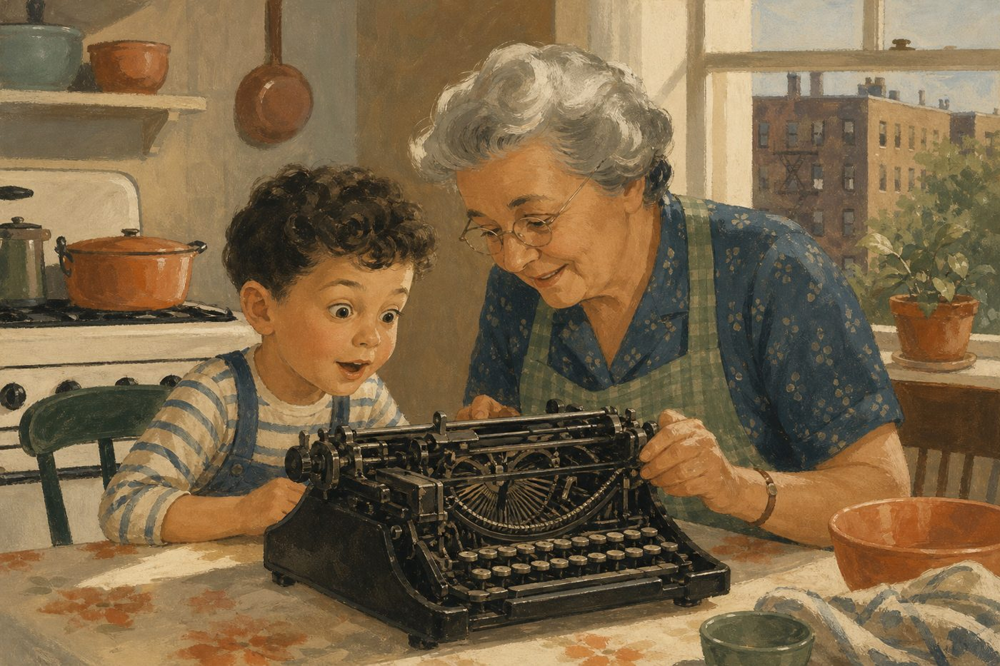

# レイ・カーツワイル 名言集 + 生い立ち（台本用の素材）

作成 2026-10-14。英語原文は Wikiquote・本人のエッセイ・インタビューから。日本語訳はこちらで付けた（公式訳ではない）。
★ = 動画で使いやすい / 出典欄が「二次」のものは記事経由なので、字幕で使う前に原文確認推奨。

---

## A. 名言集

### 1. シンギュラリティ・指数関数的成長

| # | 英語原文 | 日本語（仮訳） | 出典 |
|---|---|---|---|
| ★1 | Once a computer achieves human intelligence it will necessarily roar past it. | コンピュータが人間の知能に届いたら、必ずそのまま轟音を上げて追い抜いていく。 | The Age of Spiritual Machines (1999) |
| ★2 | The twentieth century was like twenty years' worth of change at today's rate of change. | 20世紀全体の変化は、今のペースならたった20年分だ。 | "The Singularity" in The New Humanists (2003) |
| ★3 | Exponential growth is seductive, starting out slowly and virtually unnoticeably. | 指数関数的な成長は人を欺く。最初はゆっくりで、ほとんど気づかれない。 | The Singularity Is Near (2005) p.10-11 |
| 4 | It is in the nature of exponential growth that events develop extremely slowly for extremely long periods of time. | 指数関数的成長の本質は、とても長い間、とてもゆっくりとしか物事が進まないことにある。 | The Age of Spiritual Machines (1999) |
| 5 | Most technology forecasts and forecasters ignore altogether this historical exponential view of technological progress. | ほとんどの技術予測と予測者は、この歴史的な「指数関数の見方」をまるごと無視している。 | The Singularity Is Near p.13-14 |
| 6 | We use one stage of technology to create the next stage, which is why technology accelerates, why it grows in power. | ある段階の技術を使って次の段階を作る。だから技術は加速し、力を増す。 | The New Humanists (2003) |
| 7 | Every time one paradigm ran out of steam, another took over. | 一つのパラダイムが息切れするたび、別のパラダイムが引き継いできた。 | The New Humanists (2003) |
| 8 | A primary reason that evolution—of life-forms or technology—speeds up is that it builds on its own increasing order. | 進化（生命も技術も）が加速する最大の理由は、自分が積み上げた秩序の上に積み上げるからだ。 | The Age of Spiritual Machines (1999) |
| ★9 | There will be no distinction, post-Singularity, between human and machine or between physical and virtual reality. | シンギュラリティの後には、人間と機械の区別も、現実と仮想現実の区別もなくなる。 | The Singularity Is Near p.9 |
| 10 | Ultimately, the entire universe will become saturated with our intelligence. | 最終的に、宇宙全体が私たちの知性で満たされる。 | The Singularity Is Near p.29 |
| 11 | As intelligence saturates the matter and energy available to it, it turns dumb matter into smart matter. | 知性が物質とエネルギーに染み渡ると、ただの物質が賢い物質に変わる。 | The Singularity Is Near p.364 |
| 12 | What used to fit in a building now fits in your pocket, what fits in your pocket now will fit inside a blood cell in 25 years. | かつてビル一棟分だったものが今はポケットに入る。今ポケットにあるものは25年後、血液細胞の中に入る。 | 講演で繰り返し（二次） |
| ★13 | The primary political and philosophical issue of the next century will be the definition of who we are. | 次の世紀の最大の政治的・哲学的問題は「私たちとは何者か」の定義になる。 | The Age of Spiritual Machines (1999) |

### 2. 死・寿命・肉体を超える

| # | 英語原文 | 日本語（仮訳） | 出典 |
|---|---|---|---|
| ★14 | Our mortality will be in our own hands. | 死ぬかどうかは、私たち自身の手に握られることになる。 | The Singularity Is Near p.9 |
| ★15 | We will be able to live as long as we want (a subtly different statement from saying we will live forever). | 私たちは「望むだけ長く」生きられるようになる（「永遠に生きる」とは微妙に違う）。 | The Singularity Is Near p.9 |
| 16 | It is inherently human to transcend limitations. | 限界を超えようとするのは、人間の本性そのものだ。 | 2011 インタビュー |
| 17 | I think all human beings are and should be fearful of death, but realizing that death is a real tragedy. | 人はみな死を恐れているし、恐れるべきだ。死は本当の悲劇なのだと気づけば。 | 2011 インタビュー（父の再現の記事） |
| ★18 | After 2029, you'll gain more than a year back. You'll go backward in time. | 2029年を過ぎると、1年生きるごとに1年以上の寿命が戻ってくる。時間を逆走するんだ。 | Bessemer VP インタビュー 2024-03（二次） |
| 19 | So you lose a year, you get back four months. | 今は1年生きて、4か月分の寿命が戻ってくる程度。 | TED 2024（二次） |
| 20 | 未来の人は2018年を振り返って「からだは1人に1つで、意識ファイルのバックアップもできなかったのか」と驚くだろう | — | TED 講演（日本語記事経由・要原文確認） |

### 3. 父・再現・情報と記憶

| # | 英語原文 | 日本語（仮訳） | 出典 |
|---|---|---|---|
| ★21 | I will be able to talk to this re-creation. Ultimately, it will be so realistic it will be like talking to my father. | この再現と話せるようになる。最終的には、本物の父と話すのと変わらないほどリアルになる。 | 2011 ABC News |
| 22 | That is a replica, but I can actually make a strong case that it would be more like my father. | それは複製だ。でも「本人以上に父らしい」と言える根拠はちゃんとある。 | 2011 |
| 23 | Information lasts only so long as someone cares about it. | 情報は、誰かが大切に思っている間だけ生き残る。 | The Singularity Is Near p.329 |
| ★24 | I am rather like the pattern that water makes in a stream as it rushes past the rocks in its path. | 私とは、川の水が岩を駆け抜けるときに作る「模様」のようなものだ。 | The Singularity Is Near p.383 |
| 25 | The ethical debates are like stones in a stream. The water runs around them. | 倫理の議論は川の中の石のようなもの。水はその周りを流れていく。 | The New Humanists (2003) |

### 4. 考え方・発明家の哲学

| # | 英語原文 | 日本語（仮訳） | 出典 |
|---|---|---|---|
| ★26 | At the age of five, I had the idea that I would become an inventor. | 5歳のとき、自分は発明家になるのだと思った。 | The Singularity Is Near プロローグ |
| ★27 | This, then, was the religion that I was raised with: veneration for human creativity and the power of ideas. | これが私の育った「宗教」だった。人間の創造性と、アイデアの力への敬意。 | The Singularity Is Near p.2 |
| 28 | To this day I remain convinced of this basic philosophy. | 今日に至るまで、私はこの基本哲学を信じている。 | 同 p.2 |
| 29 | The power of ideas to transform the world is itself accelerating. | 世界を変える「アイデアの力」そのものが加速している。 | 同 p.3 |
| ★30 | My grandfather's philosophy was that any problem can be solved with the right ideas. | 祖父の哲学は「どんな問題も、正しいアイデアがあれば解ける」だった。 | 本人エッセイ (writingsbyraykurzweil.com) |
| 31 | I quickly realized that you had to have a good idea of the future if you were going to succeed as an inventor. | 発明家として成功するには、未来をよく見通せなければいけないと、すぐに気づいた。 | The New Humanists (2003) |
| 32 | We can't think fast enough to logically analyze situations quickly, so we rely on our powers of pattern recognition. | 人は論理で素早く分析できるほど速く考えられない。だからパターン認識の力に頼っている。 | The New Humanists (2003) |
| 33 | AI is thus often regarded as the set of problems that have not yet been solved. | AIとは「まだ解けていない問題の集まり」だと見なされがちだ。 | The Singularity Is Near p.441 |
| 34 | Order... is information that fits a purpose. | 秩序とは、目的にかなった情報のことだ。 | The Age of Spiritual Machines (1999) |
| 35 | ラリー・ペイジからの一文の職務記述 "bring natural language understanding to Google" | 「Googleに自然言語理解をもたらしてくれ」 | Wikipedia (2012-12 入社) |

### 5. 映画・インタビュー・講演からの名言（2026-10-14 追加）

「神はまだ生まれていない」は映画『Transcendent Man』(2009) のラストの言葉。英語の原文は「Not yet」で、字幕・記事によって前後の言い回しが違う。

| # | 英語原文 | 日本語（仮訳） | 出典 |
|---|---|---|---|
| ★36 | Does God exist? Well, I would say, "Not yet." | 神は存在するか？ そうだな、「まだだ」と答える。 | 映画 Transcendent Man (2009) ラスト。Wikipedia 版は "if I was asked if god exists, I would say not yet" |
| ★37 | The AI is not coming from someplace else, like Mars. | AI はどこか別の場所、火星から来るんじゃない。（自分たちの延長だ） | MWC バルセロナ講演 2025-03 |
| ★38 | I said 2029 in 1999. | 1999 年に、2029 年と言った。（26 年変えていない） | ポッドキャスト 2024-10 |
| ★39 | We create these machines to make ourselves smarter. | 私たちがこの機械を作るのは、自分たちをもっと賢くするためだ。 | AI for Good Summit 2023-08 |
| ★40 | It's going to be very hard to imagine how you could die. | （2040 年代には）どうやったら死ねるのか、想像するほうが難しくなる。 | ポッドキャスト 2024-10 |
| 41 | By 2045, we're going to expand our own intelligence a millionfold. | 2045 年までに、私たちは自分の知能を 100 万倍にする。 | 同 2024-10 / MWC 2025 |
| 42 | Consider your cell phone. It wouldn't be very smart if it didn't connect to the cloud. | 自分の携帯を考えてみて。クラウドにつながっていなければ、たいして賢くない。（脳も同じになる） | Singularity University 2022-04 |
| 43 | By 2032, when you live through a year, you'll get back an entire year from scientific progress if you follow it carefully. | 2032 年には、1 年生きるごとに科学の進歩から丸 1 年が戻ってくる。注意深く追いかければ。 | MWC 2025-03 |
| ★44 | I don't think they're sentient yet. ... That's actually not a scientific issue. It's actually a philosophical issue. | （今の LLM は）まだ感覚を持っていないと思う。……ただしそれは科学の問題ではなく、哲学の問題だ。 | CHIP Landmark Ideas 2022-12 |
| ★45 | （師ミンスキーの言葉として）"Sentient is not scientific, so therefore forget it, it's an illusion." （カーツワイル: それは私の意見ではない） | 「感覚なんて科学的じゃない、だから忘れろ、幻想だ」。私はそうは思わない。 | 同 2022-12 |
| ★46 | If you have a world that had no sentience in it, it may as well not exist. | 感じる者が一人もいない世界なら、存在しないのと同じだ。 | 同 2022-12 |
| 47 | The emergent processes in our brains aren't controlling us; they are us. | 脳の中で創発している過程は、私たちを操っているのではない。それが私たちなのだ。 | The Singularity Is Nearer (2024) |
| 48 | We will merge with AI and augment ourselves with millions of times the computational power. | 私たちは AI と融合し、何百万倍もの計算力で自分を拡張する。 | 同 2024 |
| 49 | ...connect the upper ranges of our neocortices to the cloud, which will directly extend our thinking. | 新皮質の上層をクラウドにつなぐ。それは思考そのものを直接広げる。 | 同 2024 |
| 50 | The railroad did tremendous destruction but it also benefited society. | 鉄道は大変な破壊をもたらしたが、社会に恩恵も与えた。（AI も同じ） | AI for Good 2023-08 |
| 51 | There's no way out of it. | （オープンソース AI の悪用について）逃げ道はない。 | 同 2023-08 |
| 52 | My father had one passion, which is music. | 父にはひとつだけ情熱があった。音楽だ。 | 同 2023-08 |
| 53 | I think we'll actually probably beat 2029. | 2029 年より早く来ると思う。 | Singularity University 2022-04 |

### 5.5 「6 つのエポック」（The Singularity Is Near, 2005 第 1 章）
カーツワイルは宇宙の歴史を「情報の進化」として 6 段階に分けた。動画の「エポック 6 に向かうのか」はこれ。

| エポック | 名前 | 中身 | いつ |
|---|---|---|---|
| 1 | 物理と化学 | 原子・分子に情報が刻まれる | ビッグバン〜 |
| 2 | 生物 | DNA に情報が刻まれる | 約 40 億年前〜 |
| 3 | 脳 | 神経のパターンに情報が刻まれる | 数億年前〜 |
| 4 | 技術 | 人間がハードとソフトに情報を刻む | 数万年前〜今 |
| 5 | **技術と人間の知性の融合** | 脳の仕組みを技術に移し、技術を脳に取り込む。**ここがシンギュラリティ（2045）** | 2020〜40 年代 |
| 6 | **宇宙が目覚める** | 知性が宇宙の物質とエネルギーに染み渡る（名言 10・11） | その先 |

- 「神はまだ生まれていない（Not yet）」はエポック 6 の言い換え。宇宙が知性で満ちたとき、それを神と呼ぶかどうか、という話。
- 本人は神学的な含みを慎重に避けている。批判（シャーマーら）は「物理法則と衝突する」。

### 6. 要注意（出典が怪しい・使わない）
- "Play is just another version of work" など、文学系まとめサイトにある数本は著作に出典なし。
- 日本語記事の引用は要約・翻訳なので、原文に戻れないものは字幕にしない。

---

## B. 生い立ち（年表）

| 年 | 年齢 | できごと |
|---|---|---|
| 1868〜1938 | — | 母方の曾祖母と祖母がウィーンで**女子のための学校**を70年運営。「女の子を教育する？」と当時は物議。祖母はヨーロッパで最初期に化学の博士号を取った女性の一人（本人談） |
| 1938 | — | ヒトラーのウィーン進駐で一家はヨーロッパを脱出。父フレドリック（コンサートピアニスト・指揮者・音楽教育者）、母ハンナ（ビジュアルアーティスト）。世俗的ユダヤ人 |
| 1948-02-12 | 0 | ニューヨーク市クイーンズで誕生。妹エニッド（6歳下、会計士） |
| 幼少期 | — | ユニテリアン・ユニバーサリスト教会に通い、様々な宗教に触れる。家庭では「未来と技術」が日常の話題 |
| 1953 | 5 | 祖母が**手動タイプライター**を見せ仕組みを説明。「魔法の機械」に見えた。この時「発明家になる」と決める（★26） |
| 1955 | 7 | 両親からエレクター（組み立て玩具）セット。「発明家への道の決定的瞬間」。近所の壊れた自転車・ラジオを集めて分解 |
| 1956〜58 | 8〜10 | **トム・スウィフトJr.**シリーズを全巻読む。「主人公が地下の研究室にこもって考え、正しいアイデアひとつで難題を突破する」型に感化 |
| 1955〜56 | 7〜8 | ロボット人形劇場・ロボットゲームを自作 |
| 1960 | 12 | **コンピュータに出会う**（当時NYに十数台）。ベル研究所のエンジニアだった叔父に基礎を教わる。ヘッドスタート前身事業の統計プログラムを書く。「コンピュータと知能の関係にすぐ惹かれた」 |
| 1963 | 15 | 最初のプログラムを書く（マーティン・ヴァン・ビューレン高校） |
| 1965 | 17 | クラシック作曲家の作風を解析して**新曲を作るコンピュータ**を自作。CBS「I've Got a Secret」でその曲をピアノ演奏。国際科学フェア1位。**ウェスティングハウス科学才能コンテスト**全国入賞、ホワイトハウスで**ジョンソン大統領**と面会（大統領「君たちの世代が戦争の恐怖を見ないことが目標だ」） |
| 高校時代 | — | **マービン・ミンスキー**と文通しMITを訪問、コーネルのフランク・ローゼンブラット（パーセプトロン）も訪問 |
| 1968 | 20 | MIT 2年生で起業「Select College Consulting Program」（高校生と大学をコンピュータでマッチング）。Harcourt, Brace & World に**10万ドル**+印税で売却 |
| 1970 | 22 | MIT 卒業（計算機科学・文学）。同年、**父フレドリックが心臓発作で急死（58歳）**。以後、父の手紙・写真・楽譜・請求書までを倉庫に保管し続ける（名言21・22 の伏線） |
| 1974〜76 | 26〜28 | Kurzweil Computer Products 創業。世界初の**オムニフォントOCR**、1976-01-13 **読書機械**発表。スティーヴィー・ワンダーが愛用。Xerox に売却 |
| 1975 | 27 | 心理学者ソニア・ローゼンワルドと結婚。息子イーサン（VC）、娘エイミー（漫画家。2023年に祖父をAIで再現する過程をグラフィック回想録に） |
| 1982〜84 | 34〜36 | スティーヴィー・ワンダーとの会話から Kurzweil Music Systems 創業、K250 シンセ（グランドピアノの音を初めて再現） |
| 1983頃 | 35 | 耐糖能異常と診断。食事とサプリで生活を変える（後年 250錠/日、今は100錠/日） |
| 1990 | 42 | 『The Age of Intelligent Machines』 |
| 1999 | 51 | 『The Age of Spiritual Machines』。**2029年に機械が人間の知能に到達**と予測（以後26年間変えていない）。クリントン大統領から国家技術賞 |
| 2001〜02 | — | レメルソンMIT賞（50万ドル）、全米発明家殿堂 |
| 2005 | 57 | 『The Singularity Is Near』（邦題『ポスト・ヒューマン誕生』、新訳『シンギュラリティは近い』）。**2045年**にシンギュラリティ |
| 2010 | — | 自己採点: 147予測のうち86%が的中と主張（批判あり） |
| 2012 | 64 | 『How to Create a Mind』。**ラリー・ペイジ直々にGoogle入社** |
| 2016〜 | — | 父を**AIで再現する**プロジェクトを開始（Dad Bot） |
| 2024-06-25 | 76 | 『The Singularity Is Nearer』（邦題『シンギュラリティはより近く』NHK出版）。寿命脱出速度は2029〜32年と発言 |
| 2027-05予定 | 79 | 回想録『My Exponential Life: On Love and Inventing the Future』刊行予定（BenBella Books） |

### 台本で使える「育ち」の骨格
1. **3代の女性の系譜** … 曾祖母・祖母がウィーンで70年、女子教育を続けた。「教育は人を変える」という家。
2. **ナチスからの脱出** … 1938年に一家が逃げた体験が「正しいアイデアで問題は解ける」という祖父の哲学と、「死は悲劇」という感覚の根にある。
3. **音楽家の父 × 芸術家の母** … 技術者の家ではなく芸術家の家。だから OCR の次に作ったのが音楽シンセだった。
4. **5歳のタイプライター** … 「魔法の機械」。ここで発明家を志す。
5. **12歳でコンピュータ、17歳で全国TV** … 作曲するコンピュータ。神童エピソード。
6. **22歳で父を失う** … これが「死を技術で超える」執念と、父をAIで再現する話に直結。動画の感情の軸はここ。

---

## 主な出典
- Wikiquote: https://en.wikiquote.org/wiki/Ray_Kurzweil
- Wikipedia: https://en.wikipedia.org/wiki/Ray_Kurzweil
- 本人エッセイ（タイプライター・祖父の哲学）: https://www.writingsbyraykurzweil.com/?p=370577
- Society for Science インタビュー（曾祖母の学校・ジョンソン大統領）: https://www.societyforscience.org/blog/conversations-with-maya-ray-kurzweil/
- 父の再現 2011: https://michaelshermer.com/?p=2292 / https://www.gpb.org/news/2023/10/20/using-ai-cartoonist-amy-kurzweil-connects-deceased-grandfather-in-artificial
- 寿命脱出速度 2024: https://www.bostonmagazine.com/?p=2813679 / https://www.aol.com/lifestyle/scientist-says-humans-backwards-time-145100226.html
- 日本語記事: https://www.lifehacker.jp/article/170401_prediction_future/ / https://toyokeizai.net/articles/-/62295
- 回想録 2027: https://benbellabooks.com/shop/my-exponential-life/
